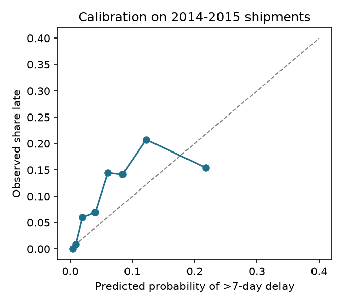

# Stock-out early warning

**Will this health facility run out of an essential medicine before its next shipment arrives?**

A small decision-support tool for public-health supply chains. It combines:

1. **A delay-risk model** trained on 10,324 real USAID shipments of HIV medicines and test kits to 40+ countries, including 1,194 shipments to Nigeria. For each incoming shipment it predicts the chance of arriving more than 7 days late.
2. **A Monte Carlo stock-out simulator.** It combines past delays for similar shipments with the facility's own consumption and its variability, and returns the probability of running out before resupply. It also gives the top-up needed to stay covered in 9 of 10 scenarios.
3. **A plain-language briefing** for a district pharmacist or logistics officer. Claude writes it from the computed numbers only, so it never adds figures of its own. Without an API key, a fixed template writes it instead.

The design goal is the one public health programs face as donor-funded logistics support winds down. With limited staff, decide which facilities and shipments to check first.

## Results (honest version)

The model was trained on 2006–2012 shipments and chosen using 2013 data. Every number below is on **unseen 2014–2015 shipments** (2,545 of them), of which 9.8% were more than 7 days late.

| Approach | ROC-AUC | PR-AUC | Brier ↓ | Late shipments caught in riskiest 10% |
| --- | --- | --- | --- | --- |
| Late rate by country (lookup) | 0.40 | 0.08 | 0.099 | 2% |
| Late rate by country × mode (lookup) | 0.69 | 0.18 | 0.095 | 23% |
| **Logistic regression (chosen on validation)** | **0.72** | 0.16 | **0.088** | 14% |
| Gradient boosting | 0.70 | 0.17 | 0.094 | 17% |

Risk bands on the test set:

| Risk band | Shipments | Share >7 days late | Mean delay (days) |
| --- | --- | --- | --- |
| Low | 664 | 0.5% | 0.3 |
| Moderate | 431 | 6.0% | 1.4 |
| Elevated | 407 | 12.5% | 3.6 |
| High | 1,043 | 16.3% | 3.9 |

What this means:

- **Delays are only partly predictable from order details.** The model ranks and calibrates better than simple lookups (higher ROC-AUC, lower Brier score). But a good country × shipping-mode lookup is a strong baseline, and it does better on top-10% recall. The baseline is reported here rather than hidden.
- **The bands are useful for ranking.** High-band shipments were late **about 30 times as often** as low-band ones (16.3% vs 0.5%). That's what the simulator needs, because it samples real delays from each band.
- A country's historical late rate on its own performs *worse than chance* on 2014–15 (ROC-AUC 0.40). Lateness patterns shifted over time. That is why the split is by time, not random.



The model **underestimates** risk in the middle of its range. For example, shipments it scored at about 6% were late about 14% of the time. The 2014–15 period had more delays than the training years: 9.8% were more than 7 days late, against 7.4% in training. Treat the raw probabilities as conservative. The simulator relies on the risk *bands* and samples real delays for each band, so this matters less for the stock-out estimate. Recalibrating on recent data would be the first fix in a live deployment.

## Design choices

- **No leakage.** The model only uses information known when a shipment is scheduled. The "recent late rate" feature uses only shipments already delivered *before* that date.
- **Split by time, not at random.** Train on 2006–12, select on 2013, test on 2014–15. This mimics using the model on future shipments.
- **Simple model wins.** Logistic regression was chosen on validation score. It is also easier to explain to non-technical colleagues.
- **Real uncertainty, not a single estimate.** Arrival day comes from the real delay distribution of the shipment's risk band. Consumption is gamma-distributed around the facility's average monthly consumption.
- **The LLM explains; it doesn't decide.** Claude (`claude-opus-5-5`, low effort, server-side refusal fallback) only turns computed numbers into a short briefing. If it fails or is offline, a template briefing is used.

## Run it

```bash
python3 -m venv .venv && source .venv/bin/activate
pip install -r requirements.txt
python -m src.train          # trains, evaluates, writes artifacts/ and reports/
streamlit run app.py
```

Optional: `export ANTHROPIC_API_KEY=...` to have Claude write the briefings.

## Project layout

```
src/data.py      load, clean, leakage-free features, time split
src/train.py     baselines + models, evaluation, risk bands, calibration plot
src/risk.py      delay probability + Monte Carlo stock-out simulation
src/briefing.py  Claude-written (or template) briefing
app.py           Streamlit interface
```

## Limits and next steps

- The data covers HIV commodities from 2006–2015. Patterns in today's malaria, family planning or essential-medicines supply chains may differ.
- Consumption is entered by the user, not forecast. A natural next step is to forecast consumption from facility LMIS data, such as Nigeria's NHLMIS, where access allows.
- The model predicts single line items. Items in the same consignment share a fate, so a consignment-level model would be cleaner.
- Next: rank redistribution options by matching facilities at high risk of stock-out with nearby facilities overstocked on the same product.

## Data

USAID Supply Chain Management System (SCMS) *Delivery History Dataset*. Data is from the USAID / PEPFAR Supply Chain Management System project, published on data.usaid.gov under CC BY-ND 4.0 with attribution to the partner. data.usaid.gov is no longer online, so `data/raw/scms_delivery_history.csv` was taken unmodified from a public mirror. SHA-256: `918b992dd3e8d4b64d2a727b2c4ea607603d0c58f19484e73f7b78528c6a8673`.
